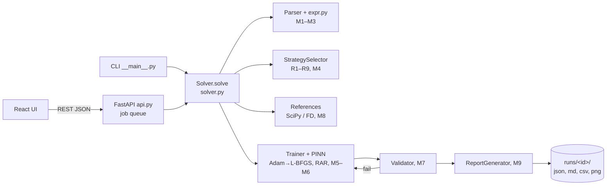

# Intelligent Differential Equation Solver Using PINNs

**Live demo:** LIVE_URL_PLACEHOLDER
**Documentation (PDF):** [`docs/PINN_Solver_Documentation.pdf`](docs/PINN_Solver_Documentation.pdf)

An **equation-aware, validation-driven solver for physics-informed neural networks (PINNs)**. You type an ODE or 1D parabolic
PDE in plain math notation. The solver:

1. Parses the problem safely and rejects anything it cannot solve, with a reason.
2. Picks a training strategy from a visible rule table (R1–R9).
3. Trains a PINN within a compute budget.
4. Validates the result on fresh points against an exact or numerical reference.
5. Refines or retries if the result fails. If the thresholds are still not met, it falls back to a numerical solver and labels the result clearly as such.

Every result comes with a full provenance report: the strategy and the reasons for it, every attempt, the losses, the errors, and the plots.

> Capstone project. The design report, review slides and poster are kept outside this repository (`../capstone review - 1`, `../capstone review - 2`).

## Features at a glance

| | |
|---|---|
| **Problem classes** | First- and second-order ODE initial value problems, second-order two-point BVPs (Dirichlet/Neumann), 1D parabolic PDEs (heat, reaction–diffusion, viscous Burgers) |
| **Input** | Plain math such as `u'' + 4u = 0`, `du/dt = -k u`, `∂u/∂t = 0.1 ∂²u/∂x²`, checked and typeset live in the UI |
| **Safety** | Own recursive-descent parser: no `eval`, no SymPy `parse_expr`/`lambdify` on user text. Bounded sizes, depths, budgets and queue |
| **Numerics** | float64 PyTorch, hard constraints where exact, Adam → L-BFGS, RAR adaptive collocation, causal time-marching, gPINN |
| **Honesty** | Pre-declared thresholds, independent validation points, reference-error estimates, labelled fallback, all failed runs reported |
| **Interfaces** | React + KaTeX + Plotly web UI, REST API (FastAPI), CLI, Python API |
| **Quality** | 138 automated tests; benchmark suite of 9 problems × 5 configurations × 3 seeds |

## Architecture



## Quick start

```bash
./run.sh                    # sets up .venv, builds the UI if needed, serves http://127.0.0.1:8000
```

Manual equivalent:

```bash
python3 -m venv .venv && .venv/bin/pip install -r requirements.txt
(cd frontend && npm install && npm run build)          # React UI -> frontend/dist
.venv/bin/uvicorn pinnsolver.api:app --port 8000        # API + UI
```

Command line, without the UI:

```bash
.venv/bin/python -m pinnsolver --benchmark heat           # built-in benchmark
.venv/bin/python -m pinnsolver my_problem.json --mode D   # your own problem (JSON, see below)
.venv/bin/python -m pytest -q                             # 138 tests
.venv/bin/python scripts/run_benchmarks.py --seeds 0 1 2  # configurations A-E, all problems
```

Tested with Python 3.10 (arm64 macOS), PyTorch 2.14, NumPy 2.2, SciPy 1.15, SymPy 1.14, Node 20.

## How the code maps to the report

| Report item | Code |
|---|---|
| M1 Problem input | `pinnsolver/spec.py` `ProblemInput`; UI form; `POST /api/jobs` |
| M2 Parser and validator | `pinnsolver/expr.py` (restricted grammar, own recursive-descent parser; **no** `eval`/`parse_expr`/`lambdify`), `pinnsolver/parser.py` `Parser` |
| M3 Equation representation | `spec.py` `EquationSpec`, `Condition` |
| M4 Strategy selector | `strategy.py` `StrategySelector`, `TrainingConfig`, `RULE_TABLE` (R1–R9) |
| M5 PINN training | `pinn.py` `PINN` (`forward`, `trial_solution`), `training.py` `Trainer` (`loss`, `train`, `retrain`) |
| M6 Adaptive collocation | `training.py` `AdaptiveSampler.refine` |
| M7 Validation | `validation.py` `Validator.check` → `ValidationResult` |
| M8 Reference solvers | `references.py`: `AnalyticalReference`, `ScipyIVPReference`, `ScipyBVPReference`, `FiniteDifferenceReference` |
| M9 Results and report | `report.py` `ReportGenerator` (`build`, `plots`, `save_run`) |
| Control loop (Fig. 6.1) | `solver.py` `Solver.solve` |
| DFD stores D1–D5 | `runs/<run_id>/problem.json` (D1), `RULE_TABLE` (D2), `training_log.csv` (D3), `reference.json` (D4), `report.json`/`report.md`/`*.png` (D5) |
| Configurations A–E (Table 6.2) | `mode="A"…"E"` everywhere; ablations of D via `ablate=[...]` |
| Benchmark protocol (Sec. 6.8) | `benchmarks.py`, `scripts/run_benchmarks.py` |
| FastAPI + React | `pinnsolver/api.py`, `frontend/` |

## Supported problems (first version)

Anything outside this list is **rejected with an explanation**. The solver
never pretends to solve it.

| Class | Form | Conditions | Reference |
|---|---|---|---|
| ODE initial value problem | order 1 or 2, explicit in the highest derivative, e.g. `u'' + w^2*u = 0` | `u(a)=…`, `u'(a)=…` at the start | exact (if given and verified) or SciPy `solve_ivp` (DOP853; Radau when stiff) |
| ODE boundary value problem | order 2, e.g. `-u'' = f(x)` | one per end, `u(a)=…` or `u'(a)=…`, at least one on `u` | exact or SciPy `solve_bvp` |
| 1D parabolic PDE | `u_t = F(x, t, u, u_x, u_xx)` with a positive `u_xx` coefficient (heat, reaction–diffusion, Burgers) | `u(x, t0)=g(x)`, `u(a,t)=…`, `u(b,t)=…` (Dirichlet) | exact or finite differences (method of lines + BDF) |

**Input syntax.**
- Derivatives: `u'`, `u''` (ODEs) or `u_t`, `u_x`, `u_xx`.
- Operators: `+ - * / ^ **` and parentheses.
- Functions: `sin cos tan exp log ln sqrt sinh cosh tanh abs`. Constants: `pi`, `e`.
- Variable names are single letters. For PDEs the time variable is `t`.
- The unknown is `u` by default; set `"dependent": "y"` (UI: "Unknown function") to write `y' = ...`.
- Parameters are named numbers, e.g. `k = 0.1`.
- Implicit multiplication: `2u`, `(1 - u)u`, and `k u` with a space. `ku` is one name (the error suggests `k*u`).
- Also understood and rewritten to the forms above: `du/dt`, `d^2u/dx^2`, `∂u/∂t`, `u'(t)`, `u(x, t)`,
  typographic characters (`′ − · × π ²`), and an equation without `=` (read as `... = 0`, with a warning).
- In the UI, domain limits may use `pi`, e.g. `2*pi`.
- The UI checks the problem as you type (via `POST /api/validate`) and shows the equation and conditions
  typeset (KaTeX), or the reason it cannot be read yet; Solve is enabled once the problem is accepted.

**Rejected before any training** (with the reason and the location):
- An equation that is undefined inside the domain: division by zero, logarithm or root of a negative number,
  e.g. `u' = 1/(t - 0.5)` on [0, 1].
- An initial value problem whose solution blows up inside the domain, e.g. `u' = u^2`, `u(0) = 1` on [0, 2]
  (the classical solver cannot pass t = 1).
- A linear boundary value problem with no unique solution, e.g. `u'' = -u`, `u(0) = u(pi) = 0`.
  A nearly non-unique one is accepted with a warning.
- An initial condition at which the equation is undefined, e.g. `u' = sqrt(u)`, `u(0) = -1`.
- Constants that are not finite real numbers (`sqrt(-1)`, `exp(1000)`, `9^9^9`), also when they only appear
  after a parameter value is substituted, and expressions that would expand into more than 5000 terms.

**Reported, not rejected.**
- If the finite-difference reference for a PDE fails (blow-up, or a front too steep for its grid), the PDE is
  still solved and the result is labelled residual-only: such a failure does not prove that no solution exists.
- A numerical reference whose own error estimate exceeds 1% of the solution size gets a warning.
- Each numerical reference solve is limited to 120 s of wall-clock time.

**Limits.**
- Expression length: 400 characters and 300 tree nodes.
- Derivative order ≤ 2.
- Time budget ≤ 900 s.
- At most 20 000 collocation points.
- One training job at a time, with up to 8 queued (`PINN_MAX_CONCURRENT`, `PINN_MAX_QUEUED`).
- Custom thresholds must be known keys (`rel_l2`, `condition_max`, `residual_rms`) with finite values in (0, 1000].
- NaN/Infinity anywhere in a request is rejected with HTTP 422.
- The server keeps the last 50 jobs in memory and the last 200 run folders on disk (`PINN_MAX_RUNS_KEPT`).

A problem file for the CLI or API:

```json
{"name": "Heat", "equation": "u_t = k*u_xx", "variables": ["x", "t"],
 "domain": {"x": [0, 1], "t": [0, 0.5]},
 "conditions": ["u(x, 0) = sin(pi*x)", "u(0, t) = 0", "u(1, t) = 0"],
 "parameters": {"k": 0.1}, "exact": "exp(-k*pi^2*t)*sin(pi*x)"}
```

`exact` is optional. A supplied exact solution is **checked**: it must satisfy
the equation and every condition. Otherwise it is ignored with a warning.

## Method details

**Network.**
- A tanh MLP in float64.
- Inputs are scaled to [−1, 1] inside the network.
- Derivatives come from autograd with respect to the *physical* coordinates, so the chain-rule factors of Eq. (6.1) are exact.

**Solution scale.**
- For a linear equation whose data are clearly not O(1) (outside [0.1, 10]) and not dominated by the source term,
  the network output is multiplied by the data size U, and residuals and condition errors in the loss are divided by U.
  The problem then trains exactly like its O(1) counterpart (`u(0) = 0.001` no longer fails).
- The absolute thresholds (IC/BC error, residual) are multiplied by U; the relative L2 threshold is unchanged.
- All nine benchmarks have O(1) data, so they are untouched and the published results remain valid (this is tested).
- If the reference solution is identically zero, the absolute RMS error is reported in place of the relative error.

**Hard constraints (Lagaris et al.).** These are used only where the construction is mathematically exact:
- IVP: `u0 + v0(t−t0) + ((t−t0)/T)^n N`.
- Dirichlet BVP: linear interpolant + `s(1−s)N`.
- Parabolic PDE: transfinite interpolation `A(x,t) + τ s(1−s) N`, used only when the initial and boundary data agree at the corners.
- Neumann conditions and incompatible corners use penalty terms. The report says which method was used for each condition.

**Loss.** `λr·mean(r²) + λb·L_bc + λi·L_ic (+ λg·mean|∇r|²)`. The penalty terms are present only for conditions that are not built in. The residual `r` is the equation as entered (left side − right side).

**Optimisation.**
- Adam with exponential learning-rate decay, then L-BFGS (strong-Wolfe line search).
- A stall detector ends Adam if the best loss improves by less than 1% over 1000 iterations.
- NaN/Inf checks restore the last finite checkpoint.
- Each attempt has a time cap, and Adam may use at most 60% of it when L-BFGS follows.

**Adaptive collocation.** RAR-style refinement:
- |r| is evaluated on fresh Sobol candidates over the whole domain.
- The top k points are **added** to the retained set, so coverage elsewhere is kept.
- Growth is limited by the point budget.

**Validation.**
- Residual RMS and maximum are computed on fresh points from a separate random stream that is never used in training.
- IC/BC errors are reported per condition.
- Relative L2 error (ε = 1e-12) and maximum error are computed on a uniform grid: 1001 points in 1D, 101×101 in 2D.
- The pre-declared thresholds are:

  | Problem type | Relative L2 | IC/BC error |
  |---|---|---|
  | ODE and BVP | ≤ 1e-3 | ≤ 1e-4 |
  | PDE | ≤ 1e-2 | ≤ 1e-3 |

- If no reference exists, the result is labelled "residual-only; true error not established".

**Reference error.**
- SciPy references are re-solved with 100× looser tolerances to estimate their own error.
- The finite-difference reference uses a grid-halving (Richardson) estimate. Its grid keeps the cell Péclet number ≤ 0.25.
- The Burgers reference agrees with an independent Cole–Hopf quadrature solution to relative L2 ≈ 1.5e-4 (see the tests).

**Mode D control loop (rules R8/R9).** At most 4 attempts within the time budget:
1. The first attempt may use ≤ 60% of the budget.
2. On failure, high-residual points are added and training continues. This repeats only while each refinement cuts the error by at least 20%.
3. Time-dependent problems (IVPs, parabolic PDEs) then get a **causal time-marching** attempt (R9). It starts from a fresh initialisation and trains over 4 growing time windows. This is what rescues the logistic benchmark, where an ordinary PINN drifts to the wrong equilibrium u ≡ 0.
4. Steep-gradient problems (R7) then try gPINN, but only if it is affordable. It is kept only if validation improves, and the cost/benefit is reported.
5. Otherwise, a wider network is tried.
6. The best attempt is kept. If the thresholds are still not met, the numerical solver's solution is shown, labelled **"Numerical fallback solver (NOT the PINN)"**.

Configurations A–C are fixed recipes for the ablation. They train until their iteration or time budget is used, with no early stop at a stall, so that the baselines are not cut short.

## Benchmarks

`benchmark_results/summary.md` holds the measured results of configurations
A–E on all nine problems with three seeds each. Every configuration of a
problem gets the same time budget and the same point budget. All failed runs
are listed. These are the only performance numbers this project reports. No
speed-up or accuracy claim is made beyond them.

## REST API

All endpoints take and return JSON. Interactive docs: `/docs` (Swagger UI) on any running server.

| Method | Path | Purpose |
|---|---|---|
| `GET` | `/api/health` | Liveness, and how many jobs are in progress |
| `GET` | `/api/info` | Modes, rule table, thresholds, limits, grammar |
| `GET` | `/api/benchmarks` | The nine built-in benchmark problems |
| `POST` | `/api/validate` | Parse and classify a problem without training (`422` with the reason if it is rejected) |
| `POST` | `/api/jobs` | Start a solve: `{"problem": {...}, "mode": "D", "seed": 0, "time_budget": 60, "thresholds": {...}, "ablate": []}` → `202` |
| `GET` | `/api/jobs` | Recent jobs |
| `GET` | `/api/jobs/{id}` | State, stage, events and live loss trace |
| `GET` | `/api/jobs/{id}/report` | Full report (`409` until the job is done) |
| `POST` | `/api/jobs/{id}/cancel` | Cancel a queued or running job |
| `GET` | `/api/runs/{run_id}/{file}` | Saved artefacts: `report.json`, `report.md`, `problem.json`, `reference.json`, `training_log.csv`, `solution.png`, `loss.png` |

```bash
curl -X POST localhost:8000/api/jobs -H 'Content-Type: application/json' \
  -d '{"problem": {"equation": "u'"'"' = -u", "variables": ["t"], "domain": {"t": [0, 1]}, "conditions": ["u(0) = 1"]}}'
```

## Deployment

The repository ships a production `Dockerfile`. It is a multi-stage build: Node builds the UI, then a slim Python image installs
CPU-only PyTorch (~200 MB instead of ~2.5 GB with CUDA) and serves the API and UI with uvicorn on `$PORT` (default 7860).

```bash
docker build -t pinn-solver .
docker run -p 7860:7860 pinn-solver          # http://localhost:7860
```

**Hugging Face Spaces (free, used for the live demo).** Create a Space with the *Docker* SDK and push this repository to it.
The Space's `README.md` needs the front matter below, which `scripts/deploy_hf_space.sh` adds for you.

```yaml
---
title: PINN Equation Solver
sdk: docker
app_port: 7860
---
```

**Render / Railway / Fly.io.** Point the service at this repository and choose the Dockerfile. The platform sets `PORT`.

Why not serverless (Vercel, Lambda)? A solve trains for up to 15 minutes in a background thread, and job state is kept in
memory between requests. Both need a long-lived process.

| Environment variable | Default | Meaning |
|---|---|---|
| `PORT` | `7860` (Docker) | HTTP port |
| `PINN_RUNS_DIR` | `runs/` (`/tmp/pinn-runs` in Docker) | Where run artefacts are written |
| `PINN_MAX_CONCURRENT` | `1` | Training jobs run in parallel |
| `PINN_MAX_QUEUED` | `8` | Jobs that may wait |
| `PINN_MAX_RUNS_KEPT` | `200` | Run folders kept on disk |

## Project structure

```
pinnsolver/          numerical core + API
  expr.py            restricted expression grammar and evaluator (NumPy and Torch)
  parser.py          problem validation and classification, friendly-notation rewriting
  spec.py            ProblemInput, EquationSpec, Condition
  strategy.py        rule table R1–R9, TrainingConfig, configurations A–E
  pinn.py            MLP and hard-constraint trial solutions
  training.py        Trainer (Adam, L-BFGS, time-marching, gPINN) and AdaptiveSampler
  references.py      analytical, solve_ivp, solve_bvp and finite-difference references
  validation.py      Validator and acceptance thresholds
  solver.py          the control loop (Fig. 6.1)
  report.py          report.json / report.md / plots
  benchmarks.py      nine benchmark problems
  api.py             FastAPI app, job queue, static UI
  __main__.py        command-line interface
frontend/            React (Vite) UI: App.jsx, Plot.jsx (Plotly, lazy-loaded), api.js
tests/               138 pytest tests
scripts/             run_benchmarks.py, deploy_hf_space.sh
benchmark_results/   measured results of configurations A–E (summary.md, csv, json)
docs/                PDF documentation and its generator
Dockerfile           production image
```

## Not implemented (by design, per the brief's roadmap)

- Arbitrary ODE/PDE systems, 2D/3D spatial domains, irregular geometries, inverse problems.
- Neumann/Robin conditions for PDEs.
- Fourier features, weak/variational forms, domain decomposition and PINODE: "advanced methods, added only when evidence supports value".
- DeepXDE cross-checks: the solver is written directly in PyTorch, and correctness is instead checked against exact solutions and independent references in the tests.

## Limitations

- A small residual is not a proof of correctness.
- Numerical references carry their own (estimated) error.
- Single-seed results vary; use the benchmark runner for statistics.
- Wall-clock budgets make results depend somewhat on the hardware.
- Not for safety-critical use without domain-specific validation and expert review.
